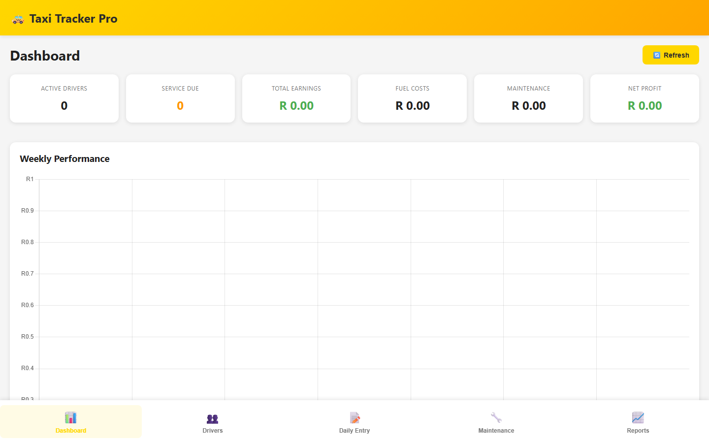

# Taxi Tracker Pro



A fleet-operations dashboard for minibus-taxi owners to track drivers, daily
takings, running costs and maintenance in one place.

## Features

- **Dashboard** — active drivers, service-due alerts, total earnings, fuel and
  maintenance costs, and net profit at a glance.
- **Drivers** and **Daily Entries** — capture per-driver takings and shifts.
- **Maintenance** — schedule and log vehicle servicing.
- **Reports** — charts (Chart.js) and summary analytics.
- **Cloud sync** with Firebase Firestore.

## Tech

`React 19` · `TypeScript` · `Vite` · `React Router` · `Chart.js` · `Firebase`

## Getting started

```bash
npm install
npm run dev
```
